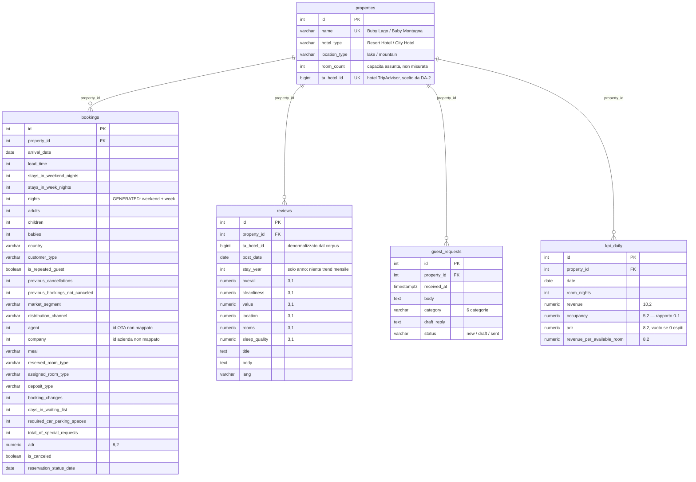

# ERD — schema v1

Schema generato da `backend/app/models.py` e applicato da Alembic
(`0001` → `0002` → `0003`). Sorgente delle decisioni: ADR 0001, ADR 0002,
ADR 0003. Dizionario dei campi: `docs/data-dictionary.md`.

## Vincoli che l'ERD non mostra

| Tabella | Vincolo | Perché |
|---|---|---|
| `properties` | `UNIQUE (ta_hotel_id)` | un hotel TripAdvisor non può essere mappato su due strutture |
| `properties` | `CHECK location_type IN ('lake','mountain')` | due soli valori ammessi dal brief |
| `bookings` | indice `(property_id, arrival_date)` | ogni KPI filtra per hotel e periodo |
| `reviews` | indice `(property_id, post_date)` | trend mensile della dashboard reputazione |
| `guest_requests` | indice `(property_id)` + `CHECK status IN ('new','draft','sent')` | Postgres non indicizza le FK da solo |
| `kpi_daily` | `UNIQUE (property_id, date)` | una sola riga per hotel e giorno |

**Nessuna FK verso `bookings` da `reviews`.** ADR 0003 §3: il legame è per
proprietà, asserito, non per prenotazione. Il `CHECK` di `kpi_daily` è
`UNIQUE`, non `CHECK`: la riga sopra è l'unica eccezione di nomenclatura.
